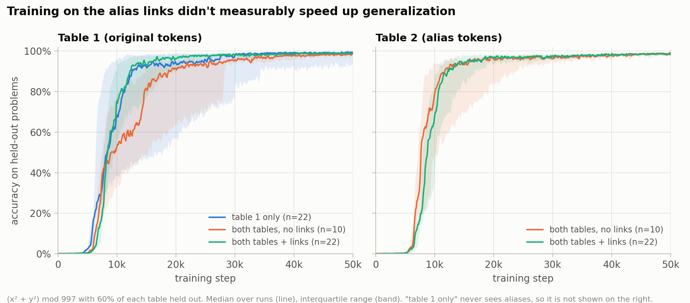

# Out-of-context learning in toy transformers

These are small-transformer experiments I ran in February–March 2024 for an [AI Safety Camp](https://www.aisafety.camp/) project on out-of-context learning (OOCL). The question was whether a model trained on statements linking two sets of tokens ("alias *a* means *i*") uses those links to answer questions it never saw directly. I built three synthetic testbeds on modular arithmetic with [TransformerLens](https://github.com/TransformerLensOrg/TransformerLens):

1. **Alias links** (`oocl.py`) is the main experiment. It has two copies of the same arithmetic table on disjoint tokens, plus training data linking each token to its copy.
2. **Grokking baseline** (`grokking.py`) measures how much of a table a model needs to see before it generalizes.
3. **Truth vs. lies** (`truth_lies.py`) asks what happens to a computation tagged "true" when the training mix shifts toward noise tagged "false".

Apart from a cleanup, the code is as it was in 2024. I added the results below in November 2026, using the training curves logged to W&B at the time (see [`results/`](results)).

## Results

### 1. Alias links didn't measurably help generalization

The script is `aisc_toymodel/src/oocl.py` and the task is (x² + y²) mod 997. The vocabulary has 997 "original" number tokens, 997 "alias" tokens (the alias of *i* is *i* + 997) and 4 special tokens. Each training step uses one batch from each of three sources:

- **table 1:** `T x y = z` on original tokens, drawn from a random 40% of the table (60% held out);
- **table 2:** the same on alias tokens, with its own independent 40% split;
- **links:** `D D a = b`, mapping each original token to its alias and back.

The loss is k₁·(table 1) + k₂·(table 2) + k₃·(links). If the model treats alias *i* as *i*, each table's training facts can fill in the other table's held-out ones: together the two splits cover 1 − 0.6² = 64% of the table. With the links on, both tables should therefore generalize sooner.



The model learns the links themselves: link loss ended at or below 0.012 in all 22 runs. However, the links had no detectable effect on the arithmetic:

| condition (k₁, k₂, k₃) | runs | table 1: runs reaching 90% | median steps | table 2: runs reaching 90% | median steps |
|---|---|---|---|---|---|
| table 1 only (1, 0, 0) | 22 | 16 | 8.4k | – | – |
| both tables, no links (1, 1, 0) | 10 | 9 | 17.2k | 9 | 10.5k |
| both tables + links (1, 1, 1) | 22 | 20 | 11.7k | 22 | 12.0k |

Accuracy was measured every 100 steps on a batch of 256 held-out problems, and "reaching 90%" means within 50k steps. For steps to 90%, links vs. no links gives a Mann–Whitney p of 0.19 for table 1 and 0.70 for table 2.

Two follow-ups pointed the same way:

- **Warm start** ([PR #1](https://github.com/ancri/mechinterp/pull/1), never merged). Starting from a model that had already learned table 1 made table 2 much easier: 49 of 51 runs reached 90%, against 27 of 51 from scratch. Adding a small link loss (k₃ = 0.1) made no consistent difference either way. These runs used k₁ = 0.1 and k₂ = 1. Each cell gives the runs reaching 90% held-out accuracy on table 2 and the median steps to get there:

  | held out | from scratch | from scratch + links | warm start | warm start + links |
  |---|---|---|---|---|
  | 60% | 1/5, 7.5k | 3/5, 8.9k | 5/5, 3.2k | 5/5, 5.1k |
  | 75% | 2/5, 8.3k | 5/5, 8.5k | 5/5, 4.1k | 5/5, 4.6k |
  | 80% | 4/5, 8.1k | 3/5, 9.2k | 5/5, 3.6k | 4/5, 5.4k |
  | 85% | 2/7, 11.2k | 2/7, 11.3k | 7/7, 4.3k | 6/7, 5.7k |
  | 90% | 5/6, 33.6k | 0/1 | 6/6, 6.8k | 1/1, 10.8k |

  Runs lasted 10k steps at 60–80% held out and up to 50k steps at 85–90%.
- **p = 1999** (one run per setting, 50k steps). The only run that generalized was the one with links at 60% held out, which reached 96% on both tables. No setting generalized at 50% or 70% held out, so I read this as run-to-run variance rather than an effect of the links.

### 2. Grokking baseline

The script is `aisc_toymodel/src/grokking.py`. A 2-layer attention-only transformer was trained on (x + y) mod 109 or (x² + y²) mod 109, with 10–95% of the table held out, until held-out loss fell below 1e-5.


For x² + y², generalization lagged further behind memorization as the training set shrank. At 75% held out, the model fit its training set by about 14k steps but took about 75k steps to generalize (classic grokking). At 90% held out it never generalized, even after 1.9M steps. For x + y, memorization and generalization happened together until there was too little data.

| task | held out | steps to train loss < 0.01 | steps to held-out loss < 0.01 |
|---|---|---|---|
| (x² + y²) mod 109 | 10% | 5.5k | 5.0k |
| | 25% | 6.8k | 8.9k |
| | 50% | 8.8k | 19.5k |
| | 75% | 14.2k | 74.6k |
| | 90% | 4.1k | not within 1.9M |
| (x + y) mod 109 | 10% | 4.1k | 3.8k |
| | 25% | 3.2k | 3.2k |
| | 50% | 10.1k | 10.3k |
| | 95% | 1.0k | not within 85k |

### 3. Truth vs. lies

The script is `aisc_toymodel/src/truth_lies.py`. Every (x² + y²) mod 109 example starts with a tag: `T` (correct answer) or `F` (uniformly random answer). Phase 1 runs for 10k steps with a share p₁ of `T` examples. Phase 2 runs for another 10k steps with a smaller share p₂. The model is evaluated on fresh `T`-tagged prompts throughout.


With no `T` examples in phase 2, the model lost the `T`-tagged arithmetic within 1,000 steps. Loss climbed back to chance (ln 109 ≈ 4.69) in every run, with 2, 4 and 8 layers. Nothing in phase 2 contradicts the `T` examples, but nothing rewards keeping them either. With 10% or more `T` examples, the model kept the arithmetic: end-of-phase-2 loss was 0.002–0.22 across 29 two-layer runs.

## Other code

- `aisc_toymodel/src/toy_model.py` holds my first experiments (late January to early February 2024). These are small sequence tasks where one group of tokens lacks a relation that the other groups show (A→B and B→C, but no C→A), to see whether the model fills it in.
- `aisc_toymodel/src/oocl_luan.py` and `train_mod.py` are Luan Fletcher's setup from our team's repo, with local modifications. The setup pretrains on multiplication mod 480, then fine-tunes on variable definitions tagged reliable or unreliable, plus questions about the defined variables.
- `aisc_toymodel/scratch/` holds exploratory notebooks from February 2024. They were run out of order and are kept only for the record.

## Running

Install the dependencies (Python 3.12):

```
pip install -r requirements.txt
```

The scripts log to W&B and read `WANDB_API_KEY` and `WANDB_ENTITY` from `aisc_toymodel/.env`. `toy_model.py` also reads `WANDB_PROJECT`. To run an experiment:

```
cd aisc_toymodel/src
python oocl.py        # or grokking.py, truth_lies.py
```

Settings live in the dataclasses at the top of each script and in the sweep loop at the bottom. Checkpoints are saved to `models/transformers/` under the working directory. If you get an opaque CUDA error, check that `d_vocab` matches the task's vocabulary; in `oocl.py` it is `2 * mod + 4`.

The figures and tables above come from `results/make_figures.py`, which reads the training curves in `results/data/`. Those curves were exported from W&B with `results/export_wandb.py`, which needs access to the team's workspace.

## Credits

This work was done during AI Safety Camp 2024 with the out-of-context learning team. `oocl_luan.py` and `train_mod.py` are adapted from Luan Fletcher's code.
