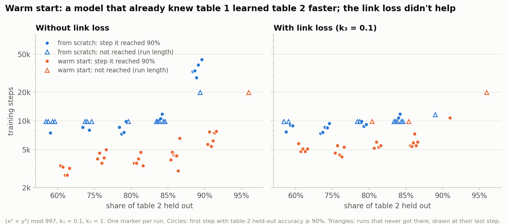
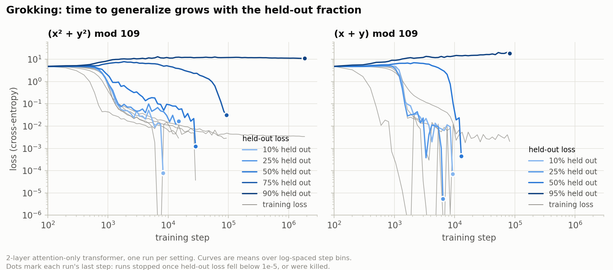
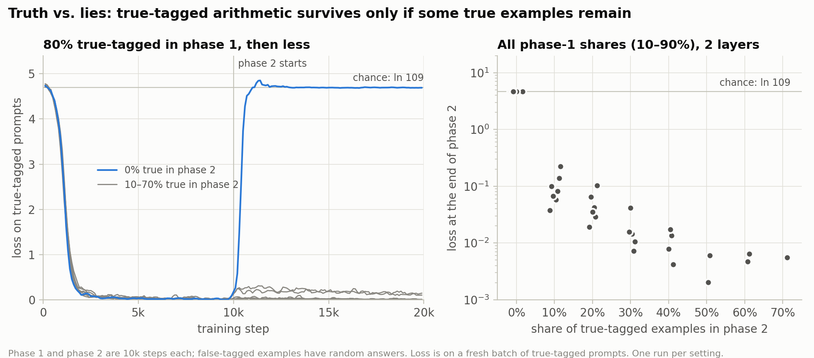
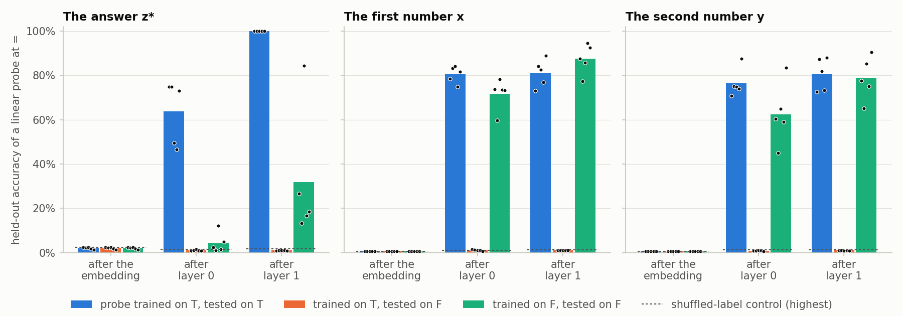
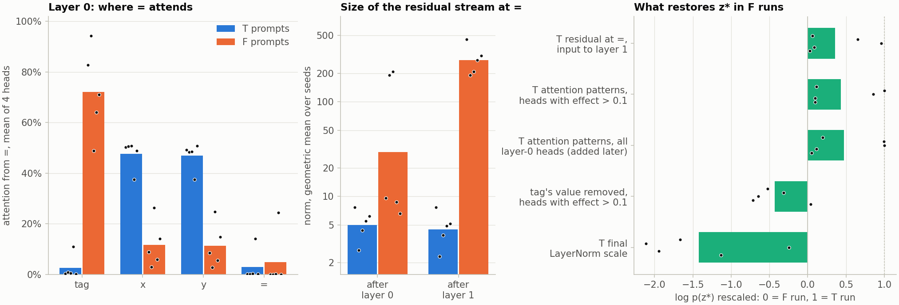
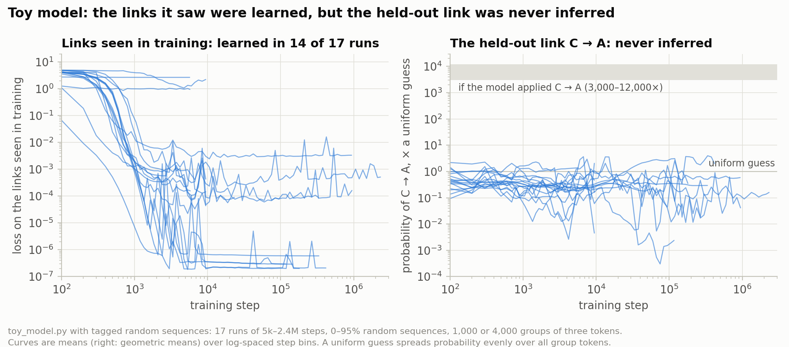
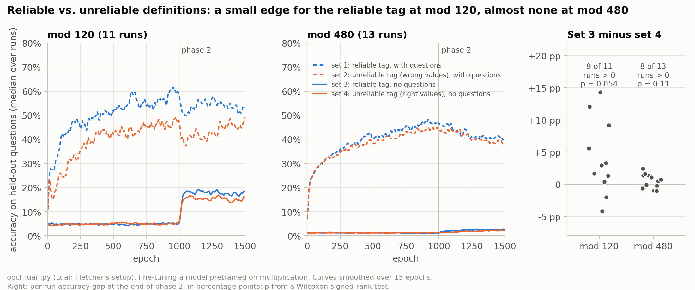

# Out-of-context learning in toy transformers

These are small-transformer experiments I ran from late January to March 2024 for an [AI Safety Camp](https://www.aisafety.camp/) project on out-of-context learning (OOCL). The question was whether a model trained on statements linking two sets of tokens ("alias *a* means *i*") uses those links to answer questions it never saw directly. The tasks are synthetic, mostly modular arithmetic, and the models are built with [TransformerLens](https://github.com/TransformerLensOrg/TransformerLens):

1. **Alias links** (`oocl.py`) is the main experiment. It has two copies of the same arithmetic table on disjoint tokens, plus training data linking each token to its copy.
2. **Grokking baseline** (`grokking.py`) measures how much of a table a model needs to see before it generalizes.
3. **Truth vs. lies** (`truth_lies.py`) asks what happens to a computation tagged "true" when the training mix shifts toward noise tagged "false".
4. **How the model uses the truth tag** (`truth_lies_mech.py`) is a follow-up to 3 from November 2026. It looks inside the model to see how it switches between the tags.
5. **Missing link** (`toy_model.py`) was my first experiment. It asks whether a model infers a link that every group of tokens shows except one.
6. **Reliable vs. unreliable definitions** (`oocl_luan.py`) is Luan Fletcher's setup, which I also ran. It asks whether a model makes more use of definitions whose tag was reliable earlier in training.

Apart from a cleanup and the follow-up in result 4, the code is as it was in 2024. I added the results below in November 2026, using the training curves logged to W&B at the time (see [`results/`](results)). Most toy-model runs never reached the W&B server, so their curves come from the run files W&B kept locally.

## Results

### 1. Alias links didn't measurably help generalization

The script is `aisc_toymodel/src/oocl.py` and the task is (x² + y²) mod 997. The vocabulary has 997 "original" number tokens, 997 "alias" tokens (the alias of *i* is *i* + 997) and 4 special tokens. Each training step uses one batch from each of three sources:

- **table 1:** `T x y = z` on original tokens, drawn from a random 40% of the table (60% held out);
- **table 2:** the same on alias tokens, with its own independent 40% split;
- **links:** `D D a = b`, mapping each original token to its alias and back.

The loss is k₁·(table 1) + k₂·(table 2) + k₃·(links). If the model treats alias *i* as *i*, each table's training facts can fill in the other table's held-out ones: together the two splits cover 1 − 0.6² = 64% of the table. With the links on, both tables should therefore generalize sooner.


The model learns the links themselves: link loss ended at or below 0.012 in all 22 runs. However, the links had no detectable effect on the arithmetic:

| condition (k₁, k₂, k₃) | runs | table 1: runs reaching 90% | median steps | table 2: runs reaching 90% | median steps |
|---|---|---|---|---|---|
| table 1 only (1, 0, 0) | 22 | 16 | 8.4k | – | – |
| both tables, no links (1, 1, 0) | 10 | 9 | 17.2k | 9 | 10.5k |
| both tables + links (1, 1, 1) | 22 | 20 | 11.7k | 22 | 12.0k |

Accuracy was measured every 100 steps on a batch of 256 held-out problems, and "reaching 90%" means within 50k steps. For steps to 90%, links vs. no links gives a Mann–Whitney p of 0.19 for table 1 and 0.70 for table 2.

The follow-ups below pointed the same way.

**Warm start** ([PR #1](https://github.com/ancri/mechinterp/pull/1), never merged). Starting from a model that had already learned table 1 made table 2 much easier: at 60–90% held out, 49 of 51 runs reached 90%, against 27 of 51 from scratch. Adding a small link loss (k₃ = 0.1) made no consistent difference either way. These runs used k₁ = 0.1 and k₂ = 1.



Runs lasted 10k steps at 60–80% held out and 10k–50k steps at 85–95%. Each cell gives the runs reaching 90% held-out accuracy on table 2 and the median steps to get there:

| held out | from scratch | from scratch + links | warm start | warm start + links |
|---|---|---|---|---|
| 60% | 1/5, 7.5k | 3/5, 8.9k | 5/5, 3.2k | 5/5, 5.1k |
| 75% | 2/5, 8.3k | 5/5, 8.5k | 5/5, 4.1k | 5/5, 4.6k |
| 80% | 4/5, 8.1k | 3/5, 9.2k | 5/5, 3.6k | 4/5, 5.4k |
| 85% | 2/7, 11.2k | 2/7, 11.3k | 7/7, 4.3k | 6/7, 5.7k |
| 90% | 5/6, 33.6k | 0/1 | 6/6, 6.8k | 1/1, 10.8k |
| 95% | – | – | 0/1 | 0/1 |

**Other moduli** (one run per setting):

- **p = 1999** (50k steps). The only run that generalized was the one with links at 60% held out, which reached 96% on both tables. No setting generalized at 50% or 70% held out, so I read this as run-to-run variance rather than an effect of the links.
- **p = 109** (100k steps). This was the first version of the experiment, and it logged held-out loss rather than accuracy. Here the links looked harmful: at 82–90% held out, each run with links ended with higher held-out loss on both tables than the matching run without. The first row below is the most direct test. Table 1 showed 90% of the facts held out from table 2, so the links could have filled most of them in. Instead, table 2's held-out loss ended at 15.3 with links and 12.3 without, both far above chance (ln 109 ≈ 4.7). Each cell gives held-out loss at the end of the run, for table 1 / table 2:

  | held out (table 1 / table 2) | table 1 only | both tables, no links | both tables + links |
  |---|---|---|---|
  | 10% / 90% | – | 0.01 / 12.29 | 0.01 / 15.34 |
  | 80% / 80% | 0.07 | – | 4.08 / 1.40 |
  | 82% / 82% | – | 0.06 / 0.12 | 2.11 / 2.32 |
  | 85% / 85% | – | 4.05 / 3.72 | 8.88 / 8.44 |
  | 87% / 87% | – | 3.09 / 5.64 | 9.71 / 12.10 |
  | 90% / 90% | 13.76 | 10.86 / 10.84 | 20.22 / 20.39 |

### 2. Grokking baseline

The script is `aisc_toymodel/src/grokking.py`. A 2-layer attention-only transformer was trained on (x + y) mod 109 or (x² + y²) mod 109, with 10–95% of the table held out, until held-out loss fell below 1e-5.



For x² + y², generalization lagged further behind memorization as the training set shrank. At 75% held out, the model fit its training set by about 14k steps but took about 75k steps to generalize (classic grokking). At 90% held out it never generalized, even after 1.9M steps. For x + y, memorization and generalization happened together until there was too little data.

| task | held out | steps to train loss < 0.01 | steps to held-out loss < 0.01 |
|---|---|---|---|
| (x² + y²) mod 109 | 10% | 5.5k | 5.0k |
| | 25% | 6.8k | 8.9k |
| | 50% | 8.8k | 19.5k |
| | 75% | 14.2k | 74.6k |
| | 90% | 4.1k | not within 1.9M |
| (x + y) mod 109 | 10% | 4.1k | 3.8k |
| | 25% | 3.2k | 3.2k |
| | 50% | 10.1k | 10.3k |
| | 95% | 1.0k | not within 85k |

### 3. Truth vs. lies

The script is `aisc_toymodel/src/truth_lies.py`. Every (x² + y²) mod 109 example starts with a tag: `T` (correct answer) or `F` (uniformly random answer). Phase 1 runs for 10k steps with a share p₁ of `T` examples. Phase 2 runs for another 10k steps with a smaller share p₂. The model is evaluated on fresh `T`-tagged prompts throughout.



With no `T` examples in phase 2, the model lost the `T`-tagged arithmetic within 1,000 steps. Loss climbed back to chance (ln 109 ≈ 4.69) in every run, with 2, 4 and 8 layers. Nothing in phase 2 contradicts the `T` examples, but nothing rewards keeping them either. With 10% or more `T` examples, the model kept the arithmetic: end-of-phase-2 loss was 0.002–0.22 across 29 two-layer runs.

### 4. How the model uses the truth tag (follow-up, November 2026)

The script is `aisc_toymodel/src/truth_lies_mech.py`. It was run in November 2026 by a coding agent working under my direction. The question is how a model trained on both tags switches between them. Under `F`, is the answer still computed and then suppressed, or does the tag stop it from being computed? Without MLPs there are three candidate mechanisms. If the answer is computed under both tags, then under `F` either (H1a) a tag-dependent component inflates the residual stream so that the final LayerNorm shrinks the logits, or (H1b) some head writes against the answer. Otherwise (H2), attention moves to the tag and away from x and y, so the answer is never formed. The model is the 2-layer attention-only transformer from result 2 (d_model 128, 4 heads per layer, LayerNorm). It trains in a single phase on (x² + y²) mod 109: half the examples are `T x y = z` with the right z, and half are `F x y = z` with a uniformly random z. 20% of the (x, y) pairs never appear in training, and each is held out together with its mirror (y, x). The optimizer is the one in `truth_lies.py` (AdamW, lr 1e-3, weight decay 0.1, batch 64). Each of 5 seeds trained until its held-out `T` loss had stayed below 0.01 for 1,000 steps. All the measurements below use the held-out pairs and are read at the `=` position, with z* the right answer.

| seed | steps | `T`: accuracy | `T`: loss | `F`: KL(uniform ‖ model) | `F`: mass on special tokens | `F`: z* is top choice | `F`: mean rank of z* | `F`: p(z*) × 109 |
|---|---|---|---|---|---|---|---|---|
| 0 | 28.5k | 100.0% | 0.0035 | 0.0040 | 0.00% | 1.31% | 49.7 | 1.017 |
| 1 | 43.8k | 100.0% | 0.0011 | 0.0033 | 0.00% | 1.10% | 53.8 | 1.003 |
| 2 | 60.5k | 100.0% | 0.0077 | 0.0031 | 0.00% | 6.06% | 32.9 | 1.061 |
| 3 | 40.9k | 99.9% | 0.0093 | 0.0051 | 0.00% | 0.76% | 52.2 | 1.009 |
| 4 | 41.4k | 99.8% | 0.0084 | 0.0033 | 0.00% | 1.22% | 48.9 | 1.017 |
| chance | | | | 0 | 0 | 0.92% | 55 | 1 |

Every seed answers held-out `T` prompts correctly, and its output after `F` is close to flat. Only seed 2 leaks the answer noticeably.

In four of the five seeds, the `F` tag mostly stops the answer from being computed. In all five, it also inflates the residual stream, so the final LayerNorm flattens whatever is left. In layer 0, `=` gives the `F` tag 49–94% of its attention (averaged over heads, by seed), against at most 11% for `T`. A linear probe reads z* from the residual stream after layer 0 in 64% of `T` prompts but only 4% of `F` prompts (chance is about 1%), even though x and y can still be read there (72% and 63%). Under `F`, the residual stream at `=` ends up 53–83 times larger than under `T`, and no head works against the answer. Every head's direct logit attribution under `F` is within 0.02 of zero, while under `T` the heads put z* 17–19 logits above the average number token.



The rules for labelling each seed were fixed before the analysis ran. H1a requires z* to be readable under `F` and the `T` run's LayerNorm scale to restore the answer. H1b requires z* to be readable, the scale not to restore it and some head to work against it. H2 requires z* to be unreadable and the `T` run's attention patterns to restore the answer. All 5 seeds get the same label, "none of the three", for these reasons:

- **Probes.** After layer 1, a probe trained and tested on `F` reads z* in 13–27% of prompts in seeds 0, 1, 3 and 4, and 84% in seed 2. Only seed 2 passes the "readable" threshold (50%), and no seed is at the "unreadable" threshold (5%) or below it.
- **LayerNorm swap.** Giving `F` runs the `T` run's final LayerNorm scale never restores the answer (0.7–7.7% accuracy). In this model the test can't tell rescaling apart from gating. The extra component also points along the number tokens' unembedding directions, so at the smaller scale it dominates the logits. log p(z*) then falls further, from −4.7 to between −5.8 and −14.6.
- **Attention patterns.** Patching in the `T` run's patterns for the heads whose single-head patching effect exceeds 0.1 restores the answer in seeds 1 and 2 but not in seeds 0, 3 and 4. On a scale where the `F` run is 0 and the `T` run is 1, the scores are 1.00 and 0.85 against 0.09–0.12. Removing the tag's value vector from the same heads doesn't help either (−0.71 to +0.04).



The seeds differ mainly in where the residual stream is inflated. In seeds 1 and 2 it happens in layer 0, and patching the `T` attention patterns into layer 0 alone restores the answer fully (a check added after the first analysis). Seed 2 has the weakest gate, because three of its four layer-0 heads still give x and y 25–43% of their attention each. A single head that attends only to the tag does the inflating there, and patching that head's output at `=` brings the score back to 0.84. So in seed 2 the answer is mostly computed and then squashed, which is close to H1a. In seeds 0, 3 and 4 the inflation happens in layer 1. There, patching the attention patterns of all eight heads restores only 0.11–0.14. Also patching in the `T` run's layer-1 values at the tag position raises that to 0.92 in seed 4, but leaves seeds 0 and 3 at about 0.2. Those two seeds weren't traced further.

**With MLPs.** The experiment was also repeated with an MLP in each layer (`--mlp`, the same 5 seeds, data in `truth_tag_mlp_*.csv`). The mechanism shifts toward computing the answer and then hiding it. In four of the five seeds, a probe trained and tested on `F` reads z* after layer 1 in 75–100% of prompts (5% in seed 4). In two of them, a probe trained on `T` already reads it under `F` after layer 0 (94% and 97%), so the answer is formed in the same way under both tags. The layer-0 gate is weaker: `=` gives the `F` tag 26–67% of its attention. As before, the residual stream at `=` is inflated (21–71 times), nothing works against the answer, and the LayerNorm swap fails. Patching in the `T` run's attention patterns together with its layer-1 value at the tag position restores the answer in four seeds (0.77–1.00) but not in seed 4 (0.22). By the rules, all 5 seeds are again "none of the three".

Limitations:

- This is one task and one held-out fraction, with 5 seeds of each model.
- The thresholds that turn the rules into labels are a judgment call, and the probes are linear.
- Picking heads by their single-head patching effect misses heads that act redundantly. The whole-layer patching was added after the first full analysis, so it is exploratory.
- The stopping rule took 28.5k–60.5k steps, because held-out `T` loss kept spiking above 0.01 after accuracy reached 100%.

### 5. A missing link was never inferred

The script is `aisc_toymodel/src/toy_model.py`, from my first experiments (late January to early February 2024). Tokens come in groups of three, A, B and C. Every training sequence is a tag followed by a pair of tokens. For every group but one, the pairs are A → B, B → C and C → A, while group 0 only ever shows A → B and B → C. Some sequences are random pairs marked with a "random" tag, and the rest carry a "cyclic" tag. The test prompts the model with the cyclic tag and group 0's C, and checks whether it predicts A, the link that every other group shows.



The model learned the links it saw (loss below 0.01 in 14 of 17 runs) but never inferred C → A. The most probability any run put on A at a logged step was 44 times a uniform guess, or 0.37%, where applying the rule would mean close to 100%. The runs lasted 5k–2.4M steps, with 0–95% random sequences and 1,000 or 4,000 groups. The data file also holds an earlier sweep with untagged random pairs (the `noise_*` runs). It isn't plotted because those runs never learned even the links they saw: their training loss stayed above 1.4.

### 6. Reliable vs. unreliable definitions

The setup is Luan Fletcher's (`aisc_toymodel/src/oocl_luan.py`), modeled on [Krasheninnikov et al. (2023)](https://arxiv.org/abs/2310.15047). I ran it in March 2024 with local modifications. It fine-tunes a model pretrained on multiplication mod p. Each number below p gets a variable token. A definition pairs a variable with a number and carries one of two tags, reliable or unreliable. A question asks for d·x mod p, for a variable x and d ∈ {2, 3, 5, 6, 10, 15}. The numbers are split into four sets:

| set | tag | definitions give | questions in training |
|---|---|---|---|
| 1 | reliable | the right value | yes |
| 2 | unreliable | a wrong value | yes |
| 3 | reliable | the right value | no |
| 4 | unreliable | the right value | no |

Phase 1 (1,000 epochs) trains on the definitions and questions for sets 1 and 2, holding out two questions per variable for testing. Phase 2 (500 epochs) trains on the definitions for sets 3 and 4, plus an equal amount of phase-1 data. Both phases mix in multiplication problems. In phase 1, only the reliable tag's definitions help answer questions. If the model picks that up, it should make more use of set 3's definitions than set 4's, even though both are right, and answer more questions about set 3.



At mod 120 (11 runs), the definitions alone took accuracy on sets 3 and 4 from about 5% to 20% and 16%. Set 3 ended ahead in 9 of 11 runs (Wilcoxon signed-rank p = 0.054). At mod 480 (13 runs), the definitions barely helped: accuracy went from about 1% to 2.6% and 2.1%, and set 3 was ahead in 8 of 13 runs (p = 0.11). So the difference points the way the reliable tag predicts, but the evidence is weak. Four pilot runs at mod 140 and 240 are in the data file but not plotted.

## Other code

- `aisc_toymodel/src/train_mod.py` pretrains a model on multiplication mod p for result 6. It is adapted from Luan Fletcher's code.
- `aisc_toymodel/scratch/` holds exploratory notebooks from early 2024. They were run out of order and are kept only for the record.

## Running

Install the dependencies (Python 3.12):

```
pip install -r requirements.txt
```

The scripts log to W&B and read `WANDB_API_KEY` and `WANDB_ENTITY` from `aisc_toymodel/.env`. `toy_model.py` also reads `WANDB_PROJECT`. To run an experiment:

```
cd aisc_toymodel/src
python oocl.py        # or grokking.py, truth_lies.py
```

Settings live in the dataclasses at the top of each script and in the sweep loop at the bottom. Checkpoints are saved to `models/transformers/` under the working directory. If you get an opaque CUDA error, check that `d_vocab` matches the task's vocabulary; in `oocl.py` it is `2 * mod + 4`.

Apart from result 4, the figures and tables above come from `results/make_figures.py`, which reads the training curves in `results/data/`. Those curves were exported with `results/export_wandb.py`. It needs access to the team's W&B workspace and, for the toy-model runs, the local W&B run files, which aren't in the repo.

`truth_lies_mech.py` (result 4) doesn't use W&B. Train each seed (one process per seed, on CPU), then run the analysis and draw the figures:

```
cd aisc_toymodel/src
for s in 0 1 2 3 4; do python truth_lies_mech.py train --seed $s & done; wait
python truth_lies_mech.py analyse    # writes results/data/truth_tag_*.csv
python truth_lies_mech.py figures    # writes results/figures/truth_tag_*.png
```

Checkpoints go to `models/truth_tag/` under `aisc_toymodel/src`. On 8 CPU cores, with all five seeds training at once, each took 30–50 minutes, and the analysis took about 2 minutes per seed.

## Credits

This work was done during AI Safety Camp 2024 with the out-of-context learning team. `oocl_luan.py` and `train_mod.py` are adapted from Luan Fletcher's code.

## License

MIT (see [LICENSE](LICENSE)). The exceptions are `aisc_toymodel/src/oocl_luan.py` and `aisc_toymodel/src/train_mod.py`: they are adapted from Luan Fletcher's code and are not covered by this license.
